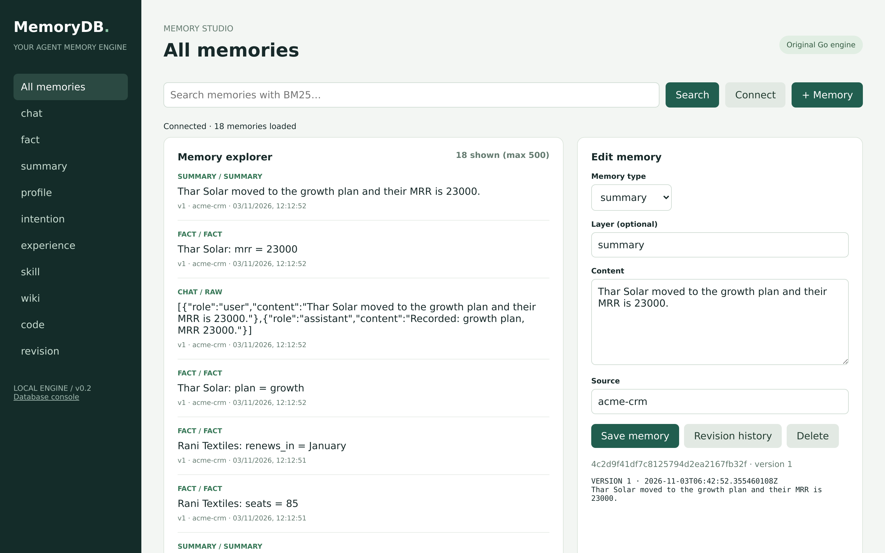
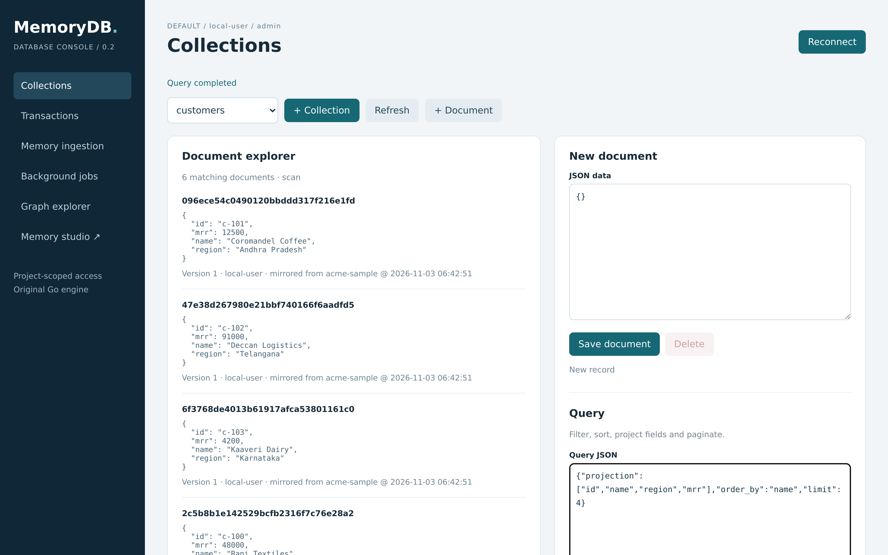

<h1 align="center">
  <picture>
    <source media="(prefers-color-scheme: dark)" srcset=".github/assets/logo-dark.svg">
    
  </picture>
</h1>

<p align="center">
  <strong>Your documents and your agent's memory, in one Go binary.</strong>
</p>

<p align="center">
  <a href="#run-it-on-your-computer">Run it on your computer</a> ·
  <a href="docs/QUICKSTART.md">Quickstart</a> ·
  <a href="docs/API.md">API</a> ·
  <a href="docs/CONNECTING.md">Connect an app or agent</a> ·
  <a href="CHANGELOG.md">Changelog</a> ·
  <a href="https://pypi.org/project/superb-memory/">PyPI</a> ·
  <a href="LICENSE">MIT</a>
</p>

<p align="center">
  <a href="https://github.com/humaniods/MemoryDB/actions/workflows/ci.yml"></a>
  <a href="https://pypi.org/project/superb-memory/"></a>
  <a href="https://github.com/humaniods/MemoryDB/releases"></a>
  <a href="LICENSE"></a>
</p>

MemoryDB is a JSON document database with agent memory built into the engine instead of bolted
on beside it. Collections, typed schemas, filters, atomic batches and a checksummed WAL sit in
the same record type as chats, evidence-linked facts, summaries, profiles and skills - each
memory keeps its own immutable revision history, is searchable by BM25 fused with exact vector
cosine, and can be traversed as a graph. It ships as one static binary with the browser console
at `/` and the memory Studio at `/studio/`, plus a pip package, a CLI, an MCP server and
Django/LangChain add-ons. `pip install superb-memory && mdb serve` is the whole setup;
`mdb demo` fills it with a sample workspace through the same connector path your real data uses.

**Status: experimental, single-node.** Working storage and application APIs, not a
PostgreSQL/MongoDB replacement or full TencentDB/Hy-Memory parity. The exact supported scope and
what is still missing are in [FEATURES](docs/FEATURES.md).

<p align="center">
  
</p>

## Get started with your coding agent

Paste this into Claude Code, Codex, Cursor or any agent that can run commands:

```text
Set up MemoryDB on this computer.

Run `pip install superb-memory` (or use the checkout I already have), start the
server with `mdb serve`, then follow README.md and docs/QUICKSTART.md to seed the
sample workspace with `mdb demo` and check `mdb health`. Keep the journal and the
token under ~/.memorydb. Ask me before deleting data, resetting the journal or
stopping anything already running, and never write the token into a file, a
commit or chat. When it is up, give me the console URL and tell me what to do
next.
```

Approve its commands one at a time rather than all `pip`/`curl` commands up front. To let the
agent use the database itself, add `memorydb-mcp` (stdio) to its MCP config -
[examples/mcp_config.json](examples/mcp_config.json) is a working file, and the server exposes
10 tools including `memorydb_sync`, `memorydb_list_sources` and `memorydb_demo`.

## Run it on your computer

Linux or macOS. `mdb serve` needs nothing but Python 3.10+: it downloads the release binary for
your OS/CPU, checks it against the release's `sha256sums.txt`, generates a token and starts the
server, keeping everything under `~/.memorydb`.

```sh
pip install superb-memory
mdb serve
```

```
  connect: memorydb://TOKEN@127.0.0.1:8080
  console: http://127.0.0.1:8080   studio: http://127.0.0.1:8080/studio/
```

**Windows has no native build**: the journal lock is advisory `flock()`, which Go only exposes on
Unix, and a `GOOS=windows` compile fails on it (`undefined: lockPath`). Use WSL or the Docker image.

**What you do next**

1. No data to hand? Run `mdb demo`: four mirrored tables (Acme Corp's customers, subscriptions,
   invoices and support tickets), notes and evidence-linked facts, seeded through the same
   connector path real data uses, so search, the graph and both UIs have something to show.
   Running it twice leaves the workspace alone.
2. Open **http://127.0.0.1:8080**, click **Connect database**, paste your token. Collections,
   document CRUD, queries, transactions, ingestion and jobs are all there.
3. Open **/studio/** to browse memories by kind, edit one and read its revision history.
4. Point your app at it: `export MEMORYDB_URL=memorydb://TOKEN@127.0.0.1:8080` and use the
   [Python](docs/CONNECTING.md), Go, Node, CLI, MCP, LangChain or Django client.
5. Have a table you already own? `mdb sync` mirrors it, row by row, and re-runs write only what
   changed.

Use `--bin <path>`, `--from <archive>` or `--source <tree>` to run a binary you already have,
`--addr`/`--data`/`--worker` to place it, and flags after `--` reach the server
(`-- -tls-cert cert.pem -tls-key key.pem`). The archive is refused if its sha256 does not match.

<p align="center">
  
</p>

## What you get

- **A document database:** collections with optional typed schemas, required fields, unique
  constraints, filtering, deterministic sorting, projection, count and cursors; atomic write
  batches of up to 256 changes; optimistic `version`/`If-Match` checks; durable idempotency
  receipts; logical deletion and per-record expiry.
- **Agent memory as records, not a side store:** `chat`, `fact`, `summary`, `profile`,
  `intention`, `experience`, `skill`, `wiki`, `code` and `revision`, every write kept as an
  immutable revision you can read back through `memories/<id>/history/`.
- **Evidence-linked ingestion:** a fact has to quote the user message it came from, with the
  message index and a confidence between 0.5 and 1, so a memory can always be traced to its
  source. Optional LLM extraction, extractive summaries and tool-trace experiences too.
- **Hybrid search:** BM25 plus model-separated exact vector cosine, fused by reciprocal rank
  fusion, scoped to what your token may read.
- **Connectors:** `mdb sync` mirrors a table you already own with one hash per row, so a nightly
  re-run writes only what actually changed - the journal sequence does not move when nothing did.
  Provenance (`connector`, `connector_key`, `source_hash`, `synced_at`) is stored on the row and
  shown in the console.
- **Two UIs in the binary:** the console (collections, transactions, ingestion, jobs, graph
  explorer) and the memory Studio, both plain HTML the server serves itself.
- **A checksummed WAL:** SHA256-framed events, fsync before publish, partial-tail recovery,
  process lock, backup/restore and compaction.
- **Clients for the stack you are in:** Python with a Django-style lazy query builder, a native
  Go client, a dependency-free Node client, the `mdb` CLI, an MCP server for agents, and Django
  cache/session and LangChain memory backends.

## Everyday commands

Every one of these runs against the server you started above.

```sh
mdb health                          # role, workspace, journal sequence
mdb demo                            # seed the sample workspace; safe to re-run
mdb collections ls                  # schemas, indexes and constraints
mdb query customers --where region=Rajasthan --fields id,name,mrr
mdb search "renewal" --limit 5      # BM25 + vectors, fused, over what you may read
mdb memory add --kind fact --content "customer: plan = growth"
mdb memory history --id <record-id> # every revision, oldest first
# these two read the sample files that ship in this repository:
mdb ingest --file examples/call.json    # chat + evidence-linked facts
mdb sync stripe --collection customers --key-field id --file examples/customers.json
mdb sources                         # which connectors exist, their rows and last sync
```

Other ways to run the server, if you would rather not use pip:

```sh
bash install.sh                              # newest release archive for this OS/CPU, sha256-checked
go install github.com/humaniods/MemoryDB@latest
go build -trimpath -ldflags "-s -w" -o memorydb .
python3 manage.py runserver -worker          # the familiar entry point
docker pull ghcr.io/humaniods/memorydb:latest # amd64 + arm64
```

```sh
export MEMORYDB_TOKEN="$(python3 -c 'import secrets; print(secrets.token_urlsafe(32))')"
./memorydb -data memory.wal -addr 127.0.0.1:8080 -worker
```

## Clients and integrations

Every client speaks one connection string, like `mongodb://` and `redis://` do:

```
memorydb://TOKEN@127.0.0.1:8080          # plain HTTP (loopback/dev)
memorydbs://TOKEN@host:443               # TLS
```

| Interface | Package / entry point | Notes |
|---|---|---|
| Python | `pip install superb-memory` → `from memorydb import MemoryDB` | reads `MEMORYDB_URL`; also `MemoryDB.from_url(...)` |
| CLI | same wheel → `mdb health / doc / query / search / memory / ingest / tx / sync / sources / demo` | scripts, cron, CI |
| MCP server | same wheel → `memorydb-mcp` (stdio) | Claude Desktop, Qoder, IDE agents; 10 tools including `memorydb_sync`; see `examples/mcp_config.json` |
| Node / TypeScript | `npm install superb-memory` · [`superb-memory`](https://www.npmjs.com/package/superb-memory) | dependency-free, Node 18+, ships `index.d.ts`; `import { MemoryDB } from 'superb-memory'` - published from `sdk/node` by the same release workflow, with npm provenance and no stored token |
| Go | `sdk/goclient` → `goclient.Connect("memorydb://…")` | stdlib only |
| LangChain | `pip install memorydb-langchain` → `MemoryDBChatMessageHistory` | needs `langchain-core`; each append is an immutable revision |
| Django | `pip install memorydb-django` → `memorydb_django.MemoryDBCache`, `memorydb_django.sessions` | two lines in `settings.py` replace the cache and session stores; TTLs use the engine's own record expiry |

Three Python names are live on PyPI and installed by name; `superb-memory` is the one every
project needs, the other two are framework add-ons that pull it in for you. The same wheels are
attached to the release and named in its `sha256sums.txt`, and `pip install
"git+https://github.com/humaniods/MemoryDB.git#subdirectory=sdk"` is the equivalent while you
review a newer commit than the last tag.

## Use from Django or another Python application

Cache and sessions are a `settings.py` drop-in, the way `sqlite3` is for Django itself:

```python
# pip install superb-memory memorydb-django
CACHES = {"default": {
    "BACKEND": "memorydb_django.MemoryDBCache",
    "LOCATION": "memorydb://TOKEN@127.0.0.1:8080",
}}
SESSION_ENGINE = "memorydb_django.sessions"   # MEMORYDB_URL env var works too
```

`cache.set("hero", payload, timeout=30)` writes one MemoryDB record carrying that TTL as the
record's own `expires`, so the server stops serving it at the deadline - no sweep cron, and
`SESSION_COOKIE_AGE` is enforced the same way. `cache.add/get_or_set/touch/delete_many/clear`
and Django's `SessionStore` contract (`create/save/load/exists/delete/flush/cycle_key`) all
behave as documented, including `CreateError` on a key collision and optimistic retries when a
concurrent writer bumps the version. `examples/django_demo.py` runs the checks through Django's
own `SessionMiddleware`.

The Python client has a custom lazy query builder for your own collections. It is not a Django
database backend: Django models, migrations, SQL joins and Django Admin integration are not
implemented. Use it from your Django service or view.

```python
import os
from memorydb import MemoryDB

db = MemoryDB(token=os.environ['MEMORYDB_TOKEN'])
# Run collection creation once during application setup.
db.collections.create('customers', fields={
    'email': {'type': 'string', 'required': True},
    'age': {'type': 'integer'},
}, unique=['email'], indexes=['age'])
Customer = db.collection('customers')
row = Customer.objects.create(email='demo@example.com', age=24,
                              idempotency_key='customer-demo-1')
rows = Customer.objects.filter(age__gte=18).order_by('-age').only('email').all()
row = Customer.objects.update(pk=row['id'], version=row['version'], age=25)
Customer.objects.delete(pk=row['id'], version=row['version'])
```

## Mirror a table instead of re-importing it

`mdb sync` pushes rows under a connector name and remembers one hash per row, so a nightly
re-run writes only what actually changed - the journal does not move when nothing did. Each row
keeps `connector`, `connector_key`, `source_hash` and `synced_at` in its own metadata, which the
console and `history/` both show, so every mirrored record can be traced back to the row it came
from. A key that a different connector - or a direct write - already owns is refused, never
taken over, while a row this connector owns is re-written from the source on every change, which
is what a mirror means.

```sh
mdb demo                                    # seed a sample workspace through this same path
mdb sync stripe --collection customers --key-field id --file examples/customers.json
mdb sync stripe --collection customers --key-field id --file examples/customers.json --delete-missing
mdb sources
```

A second run of the same rows reports `"created": 0, "updated": 0, "unchanged": 3` and leaves the
journal sequence exactly where it was - nothing was written. `examples/connectors_demo.py` does
the whole cycle through the Python client.

## Supported operations

- JSON collections, optional typed schemas, required fields, unique constraints, equality
  indexes, filtering, deterministic sorting, projection, count and cursors.
- Atomic write batches (up to 256 changes), optimistic version checks, durable idempotency
  receipts, immutable revisions, logical deletion and expiry.
- Checksummed WAL, partial-tail recovery, process lock, backup/restore and compaction.
- Workspace-scoped tokens, reader/writer/admin roles, private/team/reader-list visibility.
- BM25, model-separated exact vector cosine and reciprocal rank fusion.
- Evidence-linked chat ingestion, optional LLM fact extraction, contextual fact replacement,
  extractive summaries, tool-trace experiences and durable jobs.
- Wiki paragraph ingestion, skill approval, scoped graph traversal, Go AST call graph and
  verified Unicode revision patches.
- Connector mirroring: hash-per-row incremental sync, optional tombstones for dropped rows,
  provenance metadata, and a one-command sample workspace.

## Security model

- One bearer token per principal, mapped to a user, a workspace and a role. A reader token is
  refused on every write path; `canWrite` is owner-or-admin; every read, search and traversal is
  filtered by what that principal may see.
- The server binds `127.0.0.1:8080` unless you pass `-addr`, and the console keeps your token in
  page memory only - no session cookie, no server-side credential store.
- Request bodies are capped at 4 MiB and the HTTP boundary decodes JSON strictly: unknown fields
  and malformed payloads are rejected rather than coerced.
- Connectors are push-based and local: `mdb sync` and `mdb demo` read the files you hand them and
  talk to your own server. Nothing in this repository contacts a third-party service.
- Release archives are installed only after their sha256 matches the release's `sha256sums.txt`;
  an archive that file does not name is refused. The three Python names are published to PyPI by
  GitHub Actions through Trusted Publishing, so no index credential is stored anywhere.
- **Not audited.** This project has had no independent security review, no production load
  qualification and no live-provider memory-quality evaluation. There is no encryption at rest
  and no rate limiting.

## Documentation

| Document | What it covers |
|---|---|
| [QUICKSTART](docs/QUICKSTART.md) | The 60-second path: serve, seed, query, search, sync |
| [API](docs/API.md) | Every HTTP route, request and response shape, status codes |
| [CONNECTING](docs/CONNECTING.md) | Recipes per surface: website, agent via MCP, LangChain, Django, connectors |
| [FEATURES](docs/FEATURES.md) | What works, what is partial, what is deliberately absent |
| [OPERATIONS](docs/OPERATIONS.md) | Tokens, roles, backup/restore, compaction, jobs, TLS |
| [TEST_REPORT](docs/TEST_REPORT.md) | What has actually been run and verified, with evidence |
| [RESEARCH](docs/RESEARCH.md) / [PROVENANCE](docs/PROVENANCE.md) | Design notes, and the clean-room statement |

## Verify and develop

```sh
python3 manage.py test       # Go race tests; requires a C compiler
python3 manage.py check      # go vet
python3 tests/smoke.py       # real server + Python client + mdb CLI + recovery CLI
npm install --no-save playwright@1.62.1
npx playwright install chromium
node tests/ui.cjs            # real browser; development dependency only
node tests/screenshots.cjs   # regenerates the images in this README
```

The images above are not mockups: `tests/screenshots.cjs` builds the server from this tree, seeds
it with `mdb demo`, drives the real console and Studio in Chromium and writes the PNGs to
`.github/assets/`. Go 1.24+ is required to build (tested with Go 1.27.3); the runtime depends on
the standard library only, and no existing database engine or reference memory system is embedded
- see [PROVENANCE](docs/PROVENANCE.md).

Everything published is verified from a clean virtualenv with no checkout on the path:
`pip install superb-memory` → `mdb serve` → write and read a record, and the same for the Django
and LangChain add-ons against real Django and `langchain-core`. The release assets, the ghcr image
on both architectures and the checksum refusals are covered in
[TEST_REPORT](docs/TEST_REPORT.md); the gap it found that still matters is that vector search is an
exact scan, not ANN - everything else it listed is now closed, including the npm name
`superb-memory`, which CI publishes through npm Trusted Publishing with no stored token (that took
one human `npm publish` first, because a publisher can only be registered on a package that exists).

## Storage and consistency contract

One process owns a WAL through a sidecar lock. A transaction is one length-framed JSON event plus
SHA256 checksum. The writer validates the complete batch, appends, fsyncs, then publishes changes
to readers. Readers observe a consistent committed state while holding a read lock; the API does
not expose long-lived read transactions. A short final frame is truncated on restart. A complete
corrupt frame fails startup. An append/fsync error disables further writes until restart: the last
write's commit outcome may be unknown. Use stable idempotency keys for retryable creates and exact
transaction requests; do not blindly retry mutations.

Idempotency receipts are persistent and unbounded. HTTP PUT/PATCH/DELETE retries can fail at
version/readability checks before replaying a receipt; inspect the record/history after
uncertainty. They are not a universal exactly-once protocol.

All records/history and indexes reside in RAM. Indexes rebuild on every write; this is not an
LSM/B-tree engine. Text/vector search scans the authorized data. Request bodies are capped at
4 MiB; transactions and compaction snapshots at 32 MiB. Compaction fails safely above its
snapshot limit. No large-scale capacity, latency SLA, distributed replication, ANN, SQL, joins,
aggregation pipeline, encryption at rest or point-in-time recovery is claimed.

Deletion/expiry is logical. History, receipts, snapshots and backups can retain old content. This
is **not physical erasure**. Collection schemas cannot expire. Pagination rejects intervening
writes or changes in matching active records; restart the query after HTTP 409. No stable
multi-request snapshot is promised.

Passing tests cannot guarantee all edge cases or zero bugs. Keep important data backed up and
qualify your workload before depending on this as its sole database.

## License

[MIT](LICENSE).
