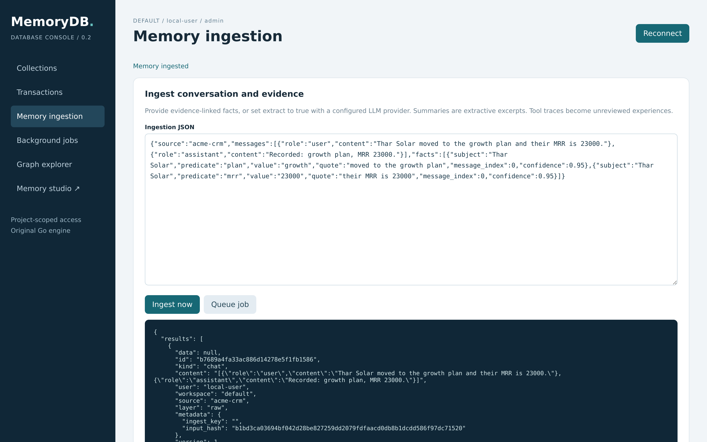
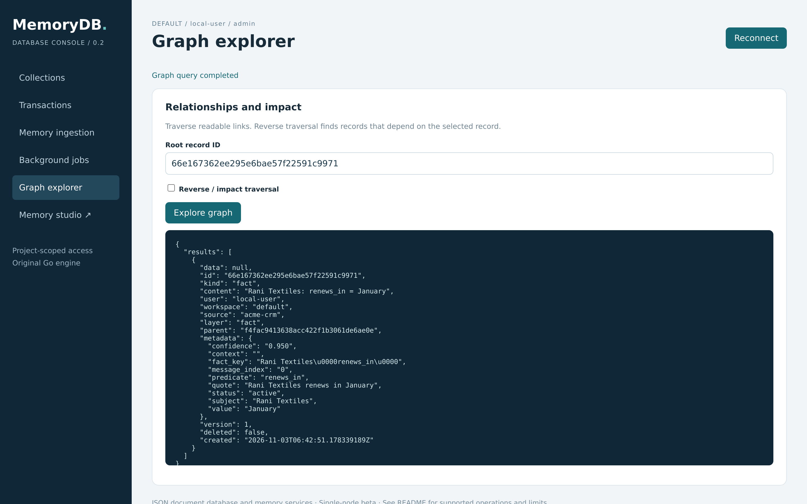

# Quickstart — 60 seconds to your first memory

## 1. Run the server (pick one)

```bash
# pip only - no clone, no Go toolchain: the client from PyPI, and `mdb serve` then fetches
# the server binary from the release and verifies its sha256 before running it
pip install superb-memory
mdb serve
#   connect: memorydb://TOKEN@127.0.0.1:8080   (data lives in ~/.memorydb/data/memory.wal)

# Container (data persists in a volume; public image, linux/amd64 and arm64)
docker run -d --name memorydb -p 127.0.0.1:8080:8080 \
  -e MEMORYDB_TOKEN="$(python3 -c 'import secrets; print(secrets.token_urlsafe(32))')" \
  -v memorydb-data:/data ghcr.io/humaniods/memorydb:latest

# Installed binary (fetches the release archive for your OS/CPU and checks its checksum)
curl -fsSL https://raw.githubusercontent.com/humaniods/MemoryDB/v0.2.1/install.sh | bash
bash install.sh          # same script, from a clone: --source . builds instead of downloading
export MEMORYDB_TOKEN="$(python3 -c 'import secrets; print(secrets.token_urlsafe(32))')"
memorydb -data memory.wal -worker

# From source
go build -o memorydb . && ./memorydb -data memory.wal -worker
```

All three Python packages install by name from PyPI — `pip install superb-memory`,
`pip install memorydb-django`, `pip install memorydb-langchain` — uploaded by the release
workflow's `pypi` job through Trusted Publishing (no index token involved). Only `superb-memory`
is required; it carries the client, `mdb` and `memorydb-mcp`, and the other two pull it in as a
dependency. For a commit newer than the last tag, install from the repository instead:

```bash
pip install "git+https://github.com/humaniods/MemoryDB.git#subdirectory=sdk"
```

and start the server you built with `mdb serve --bin ./memorydb` (or `--source .`, `--from <archive>`).

Open `http://127.0.0.1:8080` for the database console and `http://127.0.0.1:8080/studio/`
for the memory studio; paste your token into **Connect**.

## 2. Connect — one string everywhere

Every client accepts the same connection-string form (like `mongodb://` / `redis://`):

```
memorydb://TOKEN@127.0.0.1:8080        # plain HTTP (loopback)
memorydbs://TOKEN@host:443             # TLS
```

Set it once: `export MEMORYDB_URL=memorydb://$MEMORYDB_TOKEN@127.0.0.1:8080`

## 3. First calls

```bash
# curl
curl -s -H "Authorization: Bearer $MEMORYDB_TOKEN" http://127.0.0.1:8080/api/v1/health/

# CLI (pip install superb-memory provides `mdb`)
mdb health
mdb demo                      # load the sample workspace: 4 tables, notes, facts
mdb memory add --kind fact --content "user ships on fridays"
mdb search "fridays"

# Python (pip install superb-memory)
python3 -c "
from memorydb import MemoryDB
db = MemoryDB()  # reads MEMORYDB_URL
print(db.objects.search('fridays'))"

# Node (sdk/node, dependency-free, Node 18+)
node examples/node_quickstart.mjs

# Go — goclient.Connect("memorydb://TOKEN@127.0.0.1:8080")
```

**In the browser**, the same server serves two UIs. The console's *Memory ingestion* tab posts a
conversation and its evidence-linked facts, and shows the records the engine wrote:



*Graph explorer* walks the links those records create from any root record, and *Memory studio*
(`/studio/`) is where you browse a memory by kind, edit it and read its revisions.



## 4. Give your AI agent the database

- **MCP server** (any MCP client — Claude Desktop, Qoder, IDEs):
  ```json
  {"mcpServers": {"memorydb": {"command": "memorydb-mcp",
    "env": {"MEMORYDB_URL": "memorydb://TOKEN@127.0.0.1:8080"}}}}
  ```
  Tools exposed: health, search, list/add memories, ingest, create collection, query documents,
  sync a mirrored table, list connectors, seed the sample.
- **LangChain** (`pip install memorydb-langchain`, or `pip install -e sdk/langchain` from a clone):
  `MemoryDBChatMessageHistory` — drop-in chat history; every append is an immutable
  revision, so `db.objects.history(pk=...)` is a free audit trail. See `examples/langchain_demo.py`.

## 5. Documents with schemas

```python
db.collections.create("customers", fields={"email": {"type": "string", "required": True},
                                           "age": {"type": "integer"}},
                      unique=["email"], indexes=["age"])
Customer = db.collection("customers")
Customer.objects.create(data={"email": "a@x.com", "age": 30})
Customer.objects.filter(age__gte=18).order_by("-age").only("email").all()
```

## 6. Mirror a table without rewriting it every run

```bash
mdb sync stripe --collection customers --key-field id --file customers.json
#  {"created":3,"updated":0,"unchanged":0,"removed":0,"written":3,"sequence":11}
mdb sync stripe --collection customers --key-field id --file customers.json
#  {"created":0,"updated":0,"unchanged":3,"removed":0,"sequence":11}   <- nothing written, same journal sequence
```

Each row keeps the hash of the data it was written from, so a cron that re-pulls a whole CSV,
export or REST list writes only the rows whose values actually changed. Add
`--delete-missing` when the source drops rows, and `mdb sources` lists the connectors that own
data. A key already written by another connector or directly is refused, never overwritten, and
a resync needs the row's owner (or an admin). The console labels every mirrored row
(`mirrored from stripe @ <synced_at>`) so provenance is visible without an API call.
`examples/connectors_demo.py` runs the whole
cycle; `docs/API.md` documents the endpoint.

```python
db.sources.sync("stripe", collection="customers", key_field="id", items=rows)
db.sources.sync("stripe", collection="customers", key_field="id", items=rows, delete_missing=True)
db.sources.all()
```

## 7. Django: replace the cache and session stores in two lines

```bash
pip install memorydb-django          # from a clone: pip install ./sdk ./sdk/django
```

```python
# settings.py
CACHES = {"default": {
    "BACKEND": "memorydb_django.MemoryDBCache",
    "LOCATION": os.environ["MEMORYDB_URL"],      # memorydb://TOKEN@127.0.0.1:8080
}}
SESSION_ENGINE = "memorydb_django.sessions"
```

Then use Django's own API and nothing else changes:

```python
from django.core.cache import cache
cache.set("hero", {"name": "Karna"}, timeout=30)   # one record; TTL is the record's expiry
cache.get("hero")

request.session["user_id"] = 42                    # SESSION_COOKIE_AGE is enforced server-side
request.session.save()
```

This is a cache/session backend, not a Django database backend - models, migrations, SQL joins
and the admin still need a real database. `examples/django_demo.py` checks both backends against
a running server, through `SessionMiddleware`.

More: `docs/CONNECTING.md` (step-by-step: connect a website, frontend, AI agent, LangChain or
Django product), `docs/API.md` (every endpoint), `docs/OPERATIONS.md` (backup/compact/restore),
`examples/` (runnable demos).
